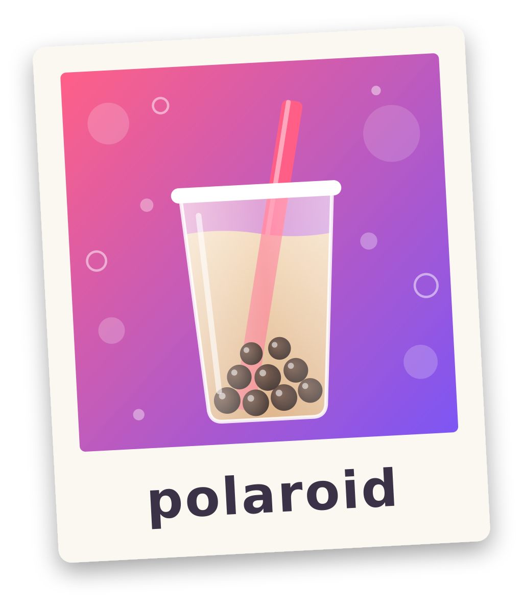

# polaroid

<p align="center"></p>

A [Bubble Tea](https://github.com/charmbracelet/bubbletea) v2 component that shows images on terminals
supporting the [Kitty graphics protocol](https://sw.kovidgoyal.net/kitty/graphics-protocol/)
([kitty](https://sw.kovidgoyal.net/kitty/), [ghostty](https://ghostty.org/)). (Kitty, Ghostty currently)
Inspired by [textual-image](https://github.com/lnqs/textual-image).

## Usage

```go
type model struct {
	pic polaroid.Model // polaroid.New(40, 20), width & height in cells
}

func (m model) Init() tea.Cmd {
	return m.pic.Init() // asks the terminal for its cell size
}

func (m model) Update(msg tea.Msg) (tea.Model, tea.Cmd) {
	switch msg := msg.(type) {
	case imageMsg:
		return m, m.pic.SetImage(msg.img) // any image.Image
	case tea.WindowSizeMsg:
		return m, m.pic.SetSize(msg.Width, msg.Height)
	case tea.KeyPressMsg:
		return m, tea.Sequence(m.pic.Clear(), tea.Quit) // free terminal memory on quit
	}

	var cmd tea.Cmd
	m.pic, cmd = m.pic.Update(msg) // handles the cell size report
	return m, cmd
}

func (m model) View() tea.View {
	return tea.NewView(m.pic.View())
}
```

The image keeps its aspect ratio and is scaled, up or down, to the largest size that fits the box. The terminal
enlarges images smaller than the box, so these may look blurry.

Support is detected from the environment (`TERM`, `TERM_PROGRAM`, `KITTY_WINDOW_ID`); override it with
`SetSupported`. On unsupported terminals `View` renders "image rendering not supported" in the box.

When serving over SSH (e.g. with [wish](https://github.com/charmbracelet/wish)), the process environment
describes the server, not the client. Detect support per session with
`m.pic.SetSupported(polaroid.Supported(sess.Environ()))`.

The image ID is sent as a 24-bit color, so Bubble Tea must use true color. This is automatic with
`TERM=xterm-kitty` or `TERM=xterm-ghostty`; with any other `TERM` (e.g. over SSH) set `COLORTERM=truecolor`.

## Example

[example/main.go](example/main.go) shows the logo and lets you zoom and pan by cropping the source image and
calling `SetImage` with the crop. Run it with `go run ./example` in kitty or ghostty.

Keys: `+`/`-` zoom, arrows or `hjkl` pan, `0` reset, `q` quit.

## Limitations

- Kitty graphics protocol only, no sixel or text fallback.
- Doesn't work inside tmux.

## Hacking

You'll need [Go](https://go.dev/) and [typos](https://github.com/crate-ci/typos). staticcheck, govulncheck and
[svu](https://github.com/caarlos0/svu) are `tool` directives in `go.mod` and run with `go tool`.

- `make test` runs the tests (with `-race`), staticcheck, govulncheck and typos. CI runs it on every push to `main`
  and on pull requests.
- `make release-patch` / `make release-minor` tag and push the next patch/minor version (computed by svu). They
  fail if the worktree isn't clean. Pushing a `v*` tag makes CI create a GitHub release.

The tests don't need a graphics terminal; to check how an image actually looks, run `go run ./example` in kitty or
ghostty.

Code map:

- `model.go`: the public `Model` and its Bubble Tea lifecycle (`Init`, `Update`, `View`, `Clear`).
- `kitty.go`: Kitty graphics escape sequences: upload and place the image, delete it, render the placeholder cells.
- `detect.go`: `Supported`, terminal support detection from the environment.
- `fit.go`: compute the cell box for an image and scale it down.
- `example/`: a demo program with zoom and pan.
